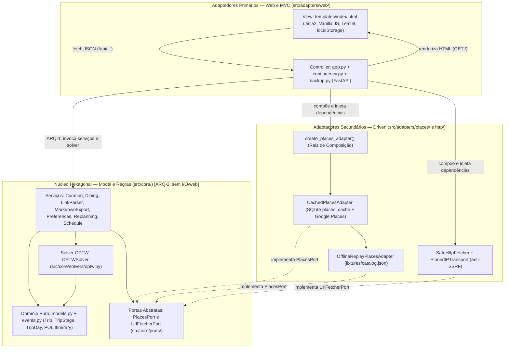
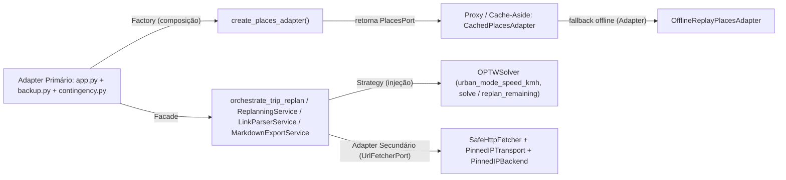

# Kairos — Traçador Dinâmico de Rotas Turísticas

[](https://www.python.org/)
[](https://www.ufjf.br/)
[](https://www.iso.org/)

**Kairos** é um sistema de planejamento e otimização dinâmica de **Viagens** multicidades sob restrições temporais e espaciais do mundo real, estruturando cada **Etapa de Viagem** em **Dias de Viagem** e **Roteiros** sobre **Pontos de Interesse (POIs)** elegíveis.

Desenvolvido para o Trabalho Prático da disciplina **DCC061 — Engenharia de Software** do Departamento de Ciência da Computação da **Universidade Federal de Juiz de Fora (UFJF)** (Prof. Fabrício Martins Mendonça), com foco aprofundado em **Testes de Software** e **Qualidade de Software**, este documento atua como guia didático integrando as **Unidades 9, 10 e 11** da disciplina diretamente aos artefatos verificáveis do repositório:

- **Unidade 9 — Arquitetura de Software**: integração prática entre **Arquitetura em Camadas**, padrão **MVC Web** e **Arquitetura Hexagonal (Ports & Adapters)**, respaldada por contratos automatizados (`ARQ-1` e `ARQ-2`) e registros de decisão arquitetural (**ADRs 0001–0007**).
- **Unidade 10 — Padrões de Projeto e Manutenibilidade**: aplicação pragmática de Padrões de Projeto GoF com análise explícita de *trade-offs* contra *overengineering* e controle de complexidade.
- **Unidade 11 — Verificação, Validação e Normas ISO**: articulação entre Pirâmide de Testes, princípios FIRST, padrão AAA (*Arrange–Act–Assert*) e métricas das normas `ISO/IEC 25010`, `ISO/IEC 5055` e `ISO/IEC/IEEE 29119`.

---

## Sumário

- [Contexto Acadêmico e Objetivos Centrais](#contexto-acadêmico-e-objetivos-centrais)
- [Vocabulário Ubíquo e Domínio](#vocabulário-ubíquo-e-domínio)
- [Arquitetura em Camadas, MVC Web e Arquitetura Hexagonal](#arquitetura-em-camadas-mvc-web-e-arquitetura-hexagonal)
  - [Visão Integrada em Diagramas](#visão-integrada-em-diagramas)
  - [Arquitetura em Camadas (Layered Architecture)](#arquitetura-em-camadas-layered-architecture)
  - [Padrão MVC Web (Model–View–Controller)](#padrão-mvc-web-modelviewcontroller)
  - [Arquitetura Hexagonal e Contratos ARQ-1 e ARQ-2](#arquitetura-hexagonal-e-contratos-arq-1-e-arq-2)
- [Documentação e Decisões Arquiteturais (ADRs)](#documentação-e-decisões-arquiteturais-adrs)
- [Padrões de Projeto GoF e Análise Anti-Overengineering](#padrões-de-projeto-gof-e-análise-anti-overengineering)
- [Verificação & Validação, Pirâmide de Testes e Normas ISO](#verificação-validação-pirâmide-de-testes-e-normas-iso)

---

## Contexto Acadêmico e Objetivos Centrais

No contexto de **DCC061 (Unidades 9, 10 e 11)**, o Kairos demonstra como decisões arquiteturais explícitas viabilizam testabilidade rigorosa, isolamento de infraestrutura externa e conformidade contínua com normas internacionais de qualidade, sem sacrificar a simplicidade operacional:

- **Otimização de Roteiro via OPTW**: Modela o planejamento de cada **Dia de Viagem** como uma variação do *Orienteering Problem with Time Windows* (OPTW), maximizando a **Pontuação de Utilidade** acumulada a partir do **Perfil de Preferência** (intensidades de `0` a `10`) e das **Listas de Curadoria**, respeitando a **Janela de Disponibilidade** do usuário, a **Janela de Funcionamento** e o **Tempo de Permanência** de cada **Ponto de Interesse (POI)**, o **Ponto de Partida/Retorno** (**Hospedagem** ativa ou ponto de chegada/saída) e o **Modal Urbano** (`driving` a 25 km/h ou `walking` a 5 km/h) no **Deslocamento**.
- **Viagens Multicidades e Hierarquia Temporal**: Organiza a **Viagem** em **Etapas de Viagem** por cidade — decompostas em **Dias de Viagem** com suporte a **Dia de Troca de Hospedagem**, **Slots de Refeição** contextuais e **Estimativa de Gastos** — conectadas por **Conexões Interurbanas** (`flying`, `transit`, `driving`, `walking` via `TransportMode`) com horário de partida (`departure_datetime`) e **Margem de Embarque** (`boarding_cutoff_minutes`).
- **Adaptação Dinâmica em Tempo Real**: Trata **Eventos de Contingência** tipados (`DelayEvent`, `ClosureEvent`, `SkipStopEvent`, `DurationAdjustmentEvent`) com **Replanejamento** automático do **Roteiro** restante, preservação de **Slots de Refeição** já reservados, emissão de alerta de risco sobre a **Conexão Interurbana** (`InterCityRiskAlert`) e propagação de datas entre **Etapas de Viagem** por **Deslocamento em Cascata**.
- **Resiliência, Cache-Aside e Modo Offline Replay**: Consome **Pontos de Interesse (POIs)** e **Listas de Curadoria** via Google Maps Platform com persistência em SQLite (*Cache-Aside*) e fallback determinístico para **Modo Offline Replay** (`OfflineReplayPlacesAdapter`, alimentado por [`src/adapters/places/fixtures/catalog.json`](./src/adapters/places/fixtures/catalog.json) com catálogos de São Paulo e Lima), permitindo avaliação acadêmica completa sem credenciais externas ([ADR 0005](./docs/adr/0005-modo-offline-replay-credenciais.md)).
- **Estado Client-Side, Validação Estrita e Exportação**: Mantém o estado da **Viagem** no `localStorage` do navegador (`kairos_trip_v1` e `kairos_trip_state_v1`), com backend FastAPI *stateless*, validação estrita de backup JSON (`validate_backup_payload`) e exportação completa em Markdown estruturado ([ADR 0007](./docs/adr/0007-gestao-de-hospedagens-curadoria-e-estado-client-side.md)).

### Execução Rápida e Verificação Local

Os comandos abaixo reproduzem o ambiente de desenvolvimento e o pipeline de verificação definidos em [`pyproject.toml`](./pyproject.toml) e [`.github/workflows/quality.yml`](./.github/workflows/quality.yml):

```bash
pip install -e ".[dev]"
bash ./verify_quality.sh                # Gate rápido: lint, mypy --strict, pytest --cov, contratos ARQ-1/ARQ-2 e ISO
uvicorn src.adapters.web.app:app        # Servidor web local (opera automaticamente em Modo Offline Replay sem GOOGLE_MAPS_API_KEY)
```

---

## Vocabulário Ubíquo e Domínio

O modelo de domínio segue estritamente os termos canônicos definidos em [`GLOSSARY.md`](./GLOSSARY.md), evitando ambiguidades entre código, documentação e interface web:

| Conceito Canônico (`GLOSSARY.md`) | Papel no Domínio | Representação Principal em `src/core/` |
| --- | --- | --- |
| **Viagem** | Planejamento global formado por **Etapas de Viagem** e **Conexões Interurbanas** | `Trip` (`src/core/domain/models.py`) |
| **Etapa de Viagem** | Recorte geográfico e temporal restrito a uma cidade, decomposto em **Dias de Viagem** | `TripStage` (`src/core/domain/models.py`) |
| **Dia de Viagem** e **Dia de Troca de Hospedagem** | Recorte de um dia no calendário associado a **Hospedagem**, **Modal Urbano** e **Roteiro** | `TripDay`, `Accommodation` (`src/core/domain/models.py`) |
| **Conexão Interurbana** e **Margem de Embarque** | Ligação de longa distância entre cidades com **Modal de Transporte** e limite operacional | `InterCityConnection`, `TransportMode` (`src/core/domain/models.py`) |
| **Ponto de Interesse (POI)** e **Lista de Curadoria** | Local elegível com coordenadas, **Janela de Funcionamento**, **Tempo de Permanência** e bonificação de curadoria | `POI`, `CurationList`, `CurationService` |
| **Roteiro**, **Deslocamento** e **Matriz de Deslocamento** | Sequência cronológica viável dentro da **Janela de Disponibilidade**, com tempos calculados conforme o **Modal Urbano** | `Itinerary`, `RouteStop`, `OPTWSolver`, `UrbanMode` |
| **Ponto de Partida/Retorno** | Coordenada inicial e final obrigatória do **Roteiro** (em geral a **Hospedagem** do dia) | `start_location`, `end_location` (`OPTWSolver.solve`) |
| **Slot de Refeição**, **Estimativa de Gastos** e **Perfil de Preferência** | Pausas alimentares contextuais, projeção financeira e pesos temáticos (`0`–`10`) sobre a **Pontuação de Utilidade** | `MealSlot`, `DiningService`, `BudgetSummary`, `PreferencesProfile` |
| **Evento de Contingência**, **Replanejamento** e **Deslocamento em Cascata** | Ocorrências em execução, recálculo do **Roteiro** restante e propagação de datas entre etapas | `events.py`, `ReplanningService`, `ScheduleService` |

---

## Arquitetura em Camadas, MVC Web e Arquitetura Hexagonal

O Kairos combina três visões arquiteturais complementares sobre o mesmo código-fonte:

1. **Arquitetura em Camadas** separa o núcleo puro de domínio e otimização (`src/core/`) da camada de adaptadores e infraestrutura (`src/adapters/`).
2. **Padrão MVC Web** organiza a entrega HTML/HTTP dentro de `src/adapters/web/` em conjunto com o modelo de domínio em `src/core/`, eliminando a sobrecarga de uma SPA ([ADR 0002](./docs/adr/0002-stack-backend-python-fastapi.md)).
3. **Arquitetura Hexagonal (*Ports & Adapters*)** aplica a inversão de dependência (DIP): o núcleo define portas abstratas (`PlacesPort` e `UrlFetcherPort`) em `src/core/ports/`, enquanto adaptadores primários (*driving*) conduzem casos de uso e adaptadores secundários (*driven*) implementam persistência SQLite, chamadas HTTP protegidas e fixtures offline.

### Visão Integrada em Diagramas

#### Diagrama em Blocos (Camadas, MVC Web, Hexagonal e Contratos)

```text
+-----------------------------------------------------------------------------------+
|                   CAMADA DE ADAPTADORES  (src/adapters/)                          |
|                                                                                   |
|  +-----------------------------------------------------------------------------+  |
|  | Adaptadores Primários / Driving (Entrada HTTP e Interface Web — MVC)        |  |
|  |                                                                             |  |
|  |  [View]     src/adapters/web/templates/index.html                           |  |
|  |             (Jinja2 + Vanilla JS + Leaflet + localStorage client-side)      |  |
|  |                |  GET /  |  fetch(/api/...)                                 |  |
|  |                v         v                                                  |  |
|  |  [Ctrl]     src/adapters/web/app.py  (14 endpoints FastAPI + DTOs)          |  |
|  |             src/adapters/web/contingency.py (orchestrate_trip_replan)       |  |
|  |             src/adapters/web/backup.py      (validate_backup_payload)       |  |
|  +-----------------------------------+-----------------------------------------+  |
|                                      | dependência unidirecional (ARQ-1)          |
|                                      v                                            |
|  +-----------------------------------------------------------------------------+  |
|  |                 NÚCLEO DA APLICAÇÃO  (src/core/)  —  ARQ-2: sem I/O/web     |  |
|  |                                                                             |  |
|  |  [Portas]   src/core/ports/places.py   -> PlacesPort(ABC)                   |  |
|  |             src/core/ports/fetcher.py  -> UrlFetcherPort(ABC)               |  |
|  |                                                                             |  |
|  |  [Serviços] src/core/services/                                              |  |
|  |   (Model)   curation.py | dining_and_budget.py | link_parser.py             |  |
|  |             markdown_export.py | preferences.py | replanning.py             |  |
|  |             schedule.py                                                     |  |
|  |                                                                             |  |
|  |  [Solver]   src/core/solvers/optw.py -> OPTWSolver (guloso + 2-opt/swap)    |  |
|  |                                                                             |  |
|  |  [Domínio]  src/core/domain/models.py (Trip, TripStage, TripDay, POI, ...)  |  |
|  |   (Model)   src/core/domain/events.py (Delay, Closure, Skip, DurationAdj.)  |  |
|  +-----------------------------------+-----------------------------------------+  |
|                                      ^  implementam Portas (Inversão / DIP)       |
|                                      |                                            |
|  +-----------------------------------+-----------------------------------------+  |
|  | Adaptadores Secundários / Driven (Persistência Local, APIs Externas e HTTP) |  |
|  |                                                                             |  |
|  |  src/adapters/places/                                                       |  |
|  |   - __init__.py       -> create_places_adapter() (Factory)                  |  |
|  |   - cached_adapter.py -> CachedPlacesAdapter(PlacesPort) [SQLite + Google]  |  |
|  |   - offline_adapter.py-> OfflineReplayPlacesAdapter(PlacesPort) [fixtures]  |  |
|  |                                                                             |  |
|  |  src/adapters/http/                                                         |  |
|  |   - safe_fetcher.py   -> SafeHttpFetcher(UrlFetcherPort) [anti-SSRF/IP pin] |  |
|  +-----------------------------------------------------------------------------+  |
+-----------------------------------------------------------------------------------+
```

#### Fluxo de Dependências e Comunicação Hexagonal



### Arquitetura em Camadas (Layered Architecture)

Na macroestrutura de diretórios em `src/`, cada subcamada possui fronteira de responsabilidade explícita e baixa complexidade estrutural:

| Camada / Pacote | Módulos | Responsabilidades Principais |
| --- | --- | --- |
| **Domínio** (`src/core/domain/`) | `models.py`, `events.py` | Entidades e *value objects* validados via `KairosModel` (`Trip`, `TripStage`, `TripDay`, `Accommodation`, `InterCityConnection`, `TransportMode`, `UrbanMode`, `POI`, `CurationList`, `Itinerary`, `RouteStop`, `MealSlot`, `PreferencesProfile`, `Coordinates`, `TimeWindow`), `collect_unknown_fields` e os quatro **Eventos de Contingência** (`DelayEvent`, `ClosureEvent`, `SkipStopEvent`, `DurationAdjustmentEvent`). |
| **Portas** (`src/core/ports/`) | `places.py`, `fetcher.py` | Contratos abstratos (`ABC`) que blindam o núcleo contra bibliotecas externas: `PlacesPort` (`get_curated_lists`, `search_places`) e `UrlFetcherPort` (`fetch_url`, `validate_url_safety`, além de `SSRFValidationError`). |
| **Serviços** (`src/core/services/`) | `curation.py`, `dining_and_budget.py`, `link_parser.py`, `markdown_export.py`, `preferences.py`, `replanning.py`, `schedule.py` | Casos de uso coesos: bonificação por **Lista de Curadoria** (`CurationService`), **Slots de Refeição** e **Estimativa de Gastos** (`DiningService`), extração de POIs via link/texto (`LinkParserService`), exportação Markdown (`MarkdownExportService`), ponderação por **Perfil de Preferência** (`PreferencesService`), **Replanejamento** com `InterCityRiskAlert` (`ReplanningService`) e **Deslocamento em Cascata** (`ScheduleService`). |
| **Solver** (`src/core/solvers/`) | `optw.py` | Motor `OPTWSolver` (heurística construtiva gulosa + busca local 2-opt/swap e `replan_remaining`), cálculo geodésico (`haversine_distance_km`, `estimate_transit_minutes`) e velocidade por **Modal Urbano** (`urban_mode_speed_kmh`: `25.0` km/h para `driving`, `5.0` km/h para `walking`). |
| **Adaptador Primário Web** (`src/adapters/web/`) | `app.py`, `contingency.py`, `backup.py`, `templates/index.html` | Raiz de composição FastAPI, DTOs de requisição/resposta, tradução de **Eventos de Contingência** (`ContingencyEventInput`, `to_domain_event`, `apply_contingency_event`, `orchestrate_trip_replan`), validação estrita de backup (`validate_backup_payload`) e interface HTML/Jinja2/Leaflet. |
| **Adaptadores Secundários de Lugares** (`src/adapters/places/`) | `__init__.py`, `cached_adapter.py`, `offline_adapter.py`, `fixtures/mock_catalog.py`, `fixtures/catalog.json` | Fábrica `create_places_adapter` com resolução de `GOOGLE_MAPS_API_KEY`, cache SQLite `places_cache` (*Cache-Aside* em `CachedPlacesAdapter`) e fallback determinístico em `OfflineReplayPlacesAdapter` com catálogos de São Paulo e Lima. |
| **Adaptador Secundário HTTP** (`src/adapters/http/`) | `safe_fetcher.py` | Implementação de `UrlFetcherPort` via `SafeHttpFetcher`, `PinnedIPTransport` e `PinnedIPBackend`, bloqueando endereços privados/loopback/link-local e fixando o IP validado contra *DNS rebinding* (SSRF). |

### Padrão MVC Web (Model–View–Controller)

Por decisão explícita do [ADR 0002](./docs/adr/0002-stack-backend-python-fastapi.md) e do [ADR 0006](./docs/adr/0006-navegacao-macro-mapa-e-detalhe-urbano.md), o sistema evita o custo de compilação e manutenção de uma SPA (como React), concentrando lógica e testes no ecossistema Python e estruturando a camada web no padrão **MVC Web**:

- **Model (`src/core/domain/` + `src/core/services/` + `src/core/solvers/optw.py`)**: concentra estado validado, regras de negócio, invariantes temporais e algoritmos de otimização/replanejamento sem qualquer acoplamento com HTTP, sessão de servidor ou HTML.
- **View (`src/adapters/web/templates/index.html`)**: template Jinja2 servido por `GET /` com CSS nativo, Vanilla JS e mapa **Leaflet**, implementando a navegação em duas camadas do [ADR 0006](./docs/adr/0006-navegacao-macro-mapa-e-detalhe-urbano.md) (visão macro geodésica da **Viagem** e visão micro urbana do **Dia de Viagem** com controles de **Evento de Contingência** e **Deslocamento em Cascata**). Persiste o estado no navegador via `localStorage` (`kairos_trip_v1` e `kairos_trip_state_v1`, conforme [ADR 0007](./docs/adr/0007-gestao-de-hospedagens-curadoria-e-estado-client-side.md)) e interage com a API via `fetch`.
- **Controller (`src/adapters/web/app.py`, `contingency.py` e `backup.py`)**: recebe requisições HTTP, valida DTOs Pydantic (`OptimizeRequest`, `ReplanRequest`, `RippleShiftRequest`, `DiningRecommendRequest`, `ContextualDiningRequest`, `BudgetRequest`, `ImportLinkRequest` e `Trip`), delega ao núcleo e traduz exceções de domínio/validação em respostas HTTP (`200`, `400`, `422`).

| Grupo Funcional | Endpoints FastAPI (`src/adapters/web/app.py`) | Papel Controller → Model |
| --- | --- | --- |
| **View & Saúde** | `GET /`, `GET /health` | Renderiza `templates/index.html` via `Jinja2Templates` e expõe status operacional da aplicação. |
| **Otimização & Contingência** | `POST /api/trip/optimize`, `POST /api/trip/replan` | Executa `CurationService` + `OPTWSolver` com `urban_mode_speed_kmh`, ou `orchestrate_trip_replan` (`ReplanningService.replan`). |
| **Calendário, Gastos & Backup** | `POST /api/trip/ripple-shift/preview`, `POST /api/trip/ripple-shift/apply`, `POST /api/trip/budget`, `POST /api/trip/export-markdown`, `POST /api/trip/backup/validate` | Delega a `ScheduleService`, `DiningService`, `MarkdownExportService` e `validate_backup_payload` (HTTP 422 para campos extras ou tipos inválidos). |
| **Gastronomia & Curadoria** | `POST /api/dining/recommend`, `POST /api/dining/contextual-slots`, `GET /api/curation/suggested`, `GET /api/places/search`, `POST /api/curation/import-link` | Coordena `DiningService`, `CurationService` (`PlacesPort`) e `LinkParserService` (`UrlFetcherPort`). |

### Arquitetura Hexagonal e Contratos ARQ-1 e ARQ-2

Na **Arquitetura Hexagonal** (*Ports & Adapters*), todas as dependências apontam de fora para dentro do hexágono (`src/core/`):

- **Adaptadores Primários (*Driving / Primary*)**: residem em `src/adapters/web/`. Eles convertem eventos externos (requisições REST e ações na View HTML/JS) em chamadas sobre os serviços e solver de `src/core/`. Em `src/adapters/web/contingency.py`, o protocolo estrutural `ContingencyEventInput(Protocol)` isola a tradução dos eventos antes de alcançar `ReplanningService.replan`.
- **Portas (*Ports*)**: residem em `src/core/ports/`. `PlacesPort` abstrai fontes de **Pontos de Interesse (POIs)** e **Listas de Curadoria**; `UrlFetcherPort` abstrai busca e validação segura de URLs externas. Como os serviços (`CurationService` e `LinkParserService`) dependem apenas dessas abstrações via injeção no construtor, torna-se trivial substituir provedores reais por dublês determinísticos em testes unitários e de integração.
- **Adaptadores Secundários (*Driven / Secondary*)**: residem em `src/adapters/places/` e `src/adapters/http/`. `CachedPlacesAdapter` e `OfflineReplayPlacesAdapter` implementam `PlacesPort`; `SafeHttpFetcher` implementa `UrlFetcherPort`. A raiz de composição em `src/adapters/web/app.py` conecta os adaptadores concretos aos serviços de núcleo usando `create_places_adapter()` e `SafeHttpFetcher()`.

Essa fronteira arquitetural não é apenas conceitual — ela é **verificada automaticamente** por meio do `import-linter` (configurado em [`pyproject.toml`](./pyproject.toml)), exercitada em testes dedicados ([`tests/unit/test_hexagonal_contracts.py`](./tests/unit/test_hexagonal_contracts.py)) e imposta como bloqueio obrigatório no gate [`./verify_quality.sh`](./verify_quality.sh):

- **`ARQ-1: camadas hexagonais`** (`type = "layers"`, `containers = ["src"]`, `layers = ["adapters", "core"]`): impõe dependência estritamente unidirecional de `src.adapters` para `src.core`. Qualquer importação de `src.adapters` dentro de `src.core` viola o contrato e reprova o build.
- **`ARQ-2: núcleo sem dependências de I/O web`** (`type = "forbidden"`, `source_modules = ["src.core"]`, `forbidden_modules = ["fastapi", "uvicorn", "jinja2", "httpx", "httpcore", "requests", "sqlite3", "socket"]`, `allow_indirect_imports = false`): proíbe o uso direto ou indireto de frameworks web, clientes HTTP, sockets e SQLite dentro de `src.core`, preservando portabilidade e testabilidade pura em memória.

---

## Documentação e Decisões Arquiteturais (ADRs)

A rastreabilidade entre requisitos, vocabulário ubíquo e implementação é mantida por documentos vivos versionados no repositório:

- [`GLOSSARY.md`](./GLOSSARY.md): Vocabulário ubíquo e conceitos canônicos do domínio (25 termos oficiais e sinônimos evitados).
- [`docs/especificacao-requisitos-funcionais.md`](./docs/especificacao-requisitos-funcionais.md): Especificação formal de requisitos funcionais (`RF01` a `RF14`).
- [`docs/testing/test-plan-29119.md`](./docs/testing/test-plan-29119.md): Plano de Testes alinhado à norma ISO/IEC/IEEE 29119 e matriz de rastreabilidade.
- [`docs/HANDOFF.md`](./docs/HANDOFF.md): Documento de contexto acadêmico, estado entregue e rastreabilidade do repositório.

| ADR | Decisão Arquitetural | Alinhamento Verificado no Código (`src/`) |
| --- | --- | --- |
| [ADR 0001: Formulação do Problema como OPTW](./docs/adr/0001-formulacao-algoritmica-optw.md) | Modelagem de seleção e sequenciamento de **POIs** como OPTW em vez de TSP | `OPTWSolver` em `src/core/solvers/optw.py` (construtivo guloso + 2-opt/swap) e `POI`/`TimeWindow`/`Itinerary` em `src/core/domain/models.py` |
| [ADR 0002: Backend em Python com FastAPI e Interface Simples](./docs/adr/0002-stack-backend-python-fastapi.md) | Backend Python/FastAPI + HTML/Jinja2 + Vanilla JS + Leaflet, sem SPA | `src/adapters/web/app.py` e `src/adapters/web/templates/index.html` (MVC Web sem etapa de build Node/React) |
| [ADR 0003: Integração Google Maps com Padrão Cache-Aside](./docs/adr/0003-integracao-google-maps-com-cache.md) | Cache SQLite obrigatório isolando chamadas externas em testes e demonstrações | `PlacesPort` (`src/core/ports/places.py`) e `CachedPlacesAdapter` (`src/adapters/places/cached_adapter.py`, tabela `places_cache`) |
| [ADR 0004: Arquitetura de Viagens Multicidades e Etapas Urbanas](./docs/adr/0004-arquitetura-viagens-multicidades.md) | Hierarquia **Viagem** → **Etapas de Viagem** → **Conexões Interurbanas**, isolando OPTW urbano | `Trip`, `TripStage`, `InterCityConnection`, `TransportMode`, `UrbanMode` (`models.py`), `ScheduleService` e `InterCityRiskAlert` (`replanning.py`) |
| [ADR 0005: Isolamento de Credenciais e Modo Offline Replay](./docs/adr/0005-modo-offline-replay-credenciais.md) | Chave via `GOOGLE_MAPS_API_KEY` com fallback automático determinístico offline | `create_places_adapter` (`src/adapters/places/__init__.py`) e `OfflineReplayPlacesAdapter` (`offline_adapter.py` + `fixtures/catalog.json` para São Paulo e Lima) |
| [ADR 0006: Navegação em Duas Camadas: Mapa Macro Geodésico e Detalhe Urbano](./docs/adr/0006-navegacao-macro-mapa-e-detalhe-urbano.md) | Visão macro da **Viagem** com conexões geodésicas e visão micro urbana com timeline de contingência | `src/adapters/web/templates/index.html` + `POST /api/trip/replan` e `src/adapters/web/contingency.py` |
| [ADR 0007: Gestão de Hospedagens, Curadoria Enriquecida e Estado Client-Side](./docs/adr/0007-gestao-de-hospedagens-curadoria-e-estado-client-side.md) | **Dias de Viagem**, **Slots de Refeição**, parser anti-SSRF, **Deslocamento em Cascata**, `localStorage` e Markdown | `Accommodation`, `TripDay`, `MealSlot`, `CurationService`, `DiningService`, `LinkParserService`, `SafeHttpFetcher`, `ScheduleService`, `MarkdownExportService`, `validate_backup_payload` |

---

## Padrões de Projeto GoF e Análise Anti-Overengineering

Na disciplina **DCC061 (Unidade 10 — Padrões de Projeto e Manutenibilidade)**, padrões do catálogo *Gang of Four* (GoF) são adotados apenas onde existe ponto real de variação ou isolamento de fronteira na **Arquitetura Hexagonal** e em **Camadas**. Cada padrão é avaliado pelo equilíbrio **Design for Change vs. Complexidade**, com teto objetivo de complexidade ciclomática e sintática `< 10` (`C901`, `radon cc` e análise AST no gate [`./verify_quality.sh`](./verify_quality.sh)).

### Visão Geral dos Padrões GoF na Arquitetura

| Padrão GoF | Categoria | Componentes Consolidados em `src/` | Fronteira / Camada | Propósito Arquitetural |
| --- | --- | --- | --- | --- |
| **Factory** | Criacional | [`create_places_adapter`](./src/adapters/places/__init__.py) e [`TripStage.create`](./src/core/domain/models.py) | Composição de Adaptadores e Domínio | Encapsular montagem de dependências externas e construção consistente de **Etapas de Viagem** |
| **Proxy / Cache-Aside** | Estrutural | [`CachedPlacesAdapter`](./src/adapters/places/cached_adapter.py) (`PlacesPort`, SQLite `places_cache`) | Adaptador Secundário (`src/adapters/places/`) | Interceptar consultas a **Pontos de Interesse (POIs)** e **Listas de Curadoria** com persistência local e *fallback* ([ADR 0003](./docs/adr/0003-integracao-google-maps-com-cache.md)) |
| **Adapter** | Estrutural | `PlacesPort`, `UrlFetcherPort`, `OfflineReplayPlacesAdapter`, `CachedPlacesAdapter`, `SafeHttpFetcher` (`PinnedIPTransport`/`PinnedIPBackend`), `app.py`, `backup.py`, `contingency.py` | Portas (`src/core/ports/`) e Adaptadores (`src/adapters/`) | Converter protocolos HTTP, SQLite, Google Places JSON e *fixtures* locais para o domínio puro (`ARQ-1`, `ARQ-2`) |
| **Facade** | Estrutural | [`orchestrate_trip_replan`](./src/adapters/web/contingency.py), [`ReplanningService.replan`](./src/core/services/replanning.py), [`LinkParserService`](./src/core/services/link_parser.py), [`MarkdownExportService`](./src/core/services/markdown_export.py) | Adaptador Web e Serviços de Núcleo | Expor pontos de entrada coesos sobre fluxos multi-etapas sem inflar controladores HTTP |
| **Strategy** | Comportamental | [`urban_mode_speed_kmh`](./src/core/solvers/optw.py) / `_URBAN_MODE_SPEED_KMH` + `transit_speed_kmh`, algoritmos `solve` vs `replan_remaining`, injeção de `PlacesPort`, `UrlFetcherPort` e `PreferencesService` | Solver OPTW, Portas e Serviços | Variar velocidade por **Modal Urbano**, algoritmo do **Roteiro** e provedores externos sem hierarquias redundantes |



### 1. Factory (`create_places_adapter` e `TripStage.create`)

- **Problema concreto**: A raiz de composição web ([`src/adapters/web/app.py`](./src/adapters/web/app.py)) e o serviço [`CurationService`](./src/core/services/curation.py) não devem depender da leitura de `GOOGLE_MAPS_API_KEY`, da definição do caminho SQLite nem do encadeamento manual do *fallback* offline. No domínio, instanciar uma **Etapa de Viagem** exige gerar os **Dias de Viagem** no intervalo `[start_date, end_date)` e encadear `previous_day_accommodation` para identificar cada **Dia de Troca de Hospedagem**.
- **Aplicação no sistema consolidado**:
  - **Fábrica na borda de composição**: `create_places_adapter(api_key, cache_path, fallback_adapter) -> PlacesPort` em [`src/adapters/places/__init__.py`](./src/adapters/places/__init__.py) lê `GOOGLE_MAPS_API_KEY` via `os.getenv` quando `api_key` é `None`, instancia [`CachedPlacesAdapter`](./src/adapters/places/cached_adapter.py) com [`OfflineReplayPlacesAdapter`](./src/adapters/places/offline_adapter.py) (ou *fallback* de teste) e devolve apenas o contrato abstrato [`PlacesPort`](./src/core/ports/places.py).
  - **Factory Method de domínio**: `TripStage.create(id, city_name, start_date, end_date, base_accommodation) -> TripStage` em [`src/core/domain/models.py`](./src/core/domain/models.py) cria a **Etapa de Viagem** e executa `_generate_days()`, mantendo os **Dias de Viagem** consistentes desde a construção.
- **Trade-off (*Design for Change vs. Complexidade*)**: Adota uma função fábrica enxuta (`create_places_adapter`, 12 linhas no corpo da função) e um único `@classmethod` (`TripStage.create`) em vez de uma hierarquia *Abstract Factory* (`PlacesFactory`, `GooglePlacesFactory`, `OfflinePlacesFactory`) ou classes *Builder* dedicadas. Novos provedores de lugares exigem alteração apenas dentro de `create_places_adapter` (*Design for Change*), evitando classes de indireção sem ganho atual.

### 2. Proxy / Cache-Aside (`CachedPlacesAdapter`)

- **Problema concreto**: Chamadas diretas às APIs da Google Maps Platform geram latência, consumo de cota, instabilidade em suítes de testes automatizados e falhas quando a aplicação roda em ambiente acadêmico sem credenciais ([ADR 0003](./docs/adr/0003-integracao-google-maps-com-cache.md) e [ADR 0005](./docs/adr/0005-modo-offline-replay-credenciais.md)). O núcleo precisa acessar **Pontos de Interesse (POIs)** e **Listas de Curadoria** sem qualquer dependência de SQLite ou HTTP.
- **Aplicação no sistema consolidado**: [`CachedPlacesAdapter`](./src/adapters/places/cached_adapter.py) implementa a mesma interface [`PlacesPort`](./src/core/ports/places.py) que seu sujeito encapsulado (`fallback_adapter: PlacesPort`, por padrão `OfflineReplayPlacesAdapter`). Em `get_curated_lists` e `search_places`, consulta primeiro a tabela SQLite `places_cache` via `_read_cache`: em *cache hit*, reconstrói `CurationList` e `POI` via `model_validate`; em *cache miss*, `get_curated_lists` delega ao `fallback_adapter`, enquanto `search_places` executa `_fetch_places_on_miss` (tentando `_fetch_external_places` via `httpx.get` se `api_key` estiver configurada e recorrendo ao `fallback_adapter` offline caso contrário), gravando a resposta com `_write_cache` e oferecendo `clear_cache()`.
- **Trade-off (*Design for Change vs. Complexidade*)**: Reunir **Proxy** estrutural (`PlacesPort`) e **Cache-Aside** sobre `sqlite3` nativo em um único módulo de 138 linhas evita infraestrutura externa (como Redis), ORM ou abstrações especulativas (`CacheBackendInterface`, `CacheKeyStrategy`). O parâmetro `cache_path` (incluindo `:memory:` e `tmp_path` em testes isolados) garante determinismo, mantém `sqlite3` confinado a `src/adapters/` (`ARQ-2`) e preserva complexidade ciclomática máxima `6` (`search_places`).

### 3. Adapter (Portas Hexagonais, HTTP Anti-SSRF e Camada Web)

- **Problema concreto**: O núcleo em `src/core/` é proibido pelo contrato `ARQ-2` de importar `fastapi`, `httpx`, `httpcore`, `sqlite3` ou `socket`, e pelo contrato `ARQ-1` de importar `src/adapters/`. Logo, todos os formatos externos (requisições REST, JSON de backup, Google Places API, *fixtures* locais e clientes HTTP) precisam ser traduzidos na fronteira do hexágono.
- **Aplicação no sistema consolidado**:
  - **Adaptadores Secundários (*Driven*)**: [`OfflineReplayPlacesAdapter`](./src/adapters/places/offline_adapter.py) adapta [`fixtures/catalog.json`](./src/adapters/places/fixtures/catalog.json) (catálogos de São Paulo e Lima carregados por `load_mock_catalog`) para `PlacesPort`; [`CachedPlacesAdapter`](./src/adapters/places/cached_adapter.py) adapta respostas JSON do Google Places (`_parse_google_places_response`) e registros SQLite para modelos de domínio; e [`SafeHttpFetcher`](./src/adapters/http/safe_fetcher.py), apoiado por `PinnedIPTransport(httpx.HTTPTransport)` e `PinnedIPBackend(httpcore.SyncBackend)`, adapta `httpx`/`httpcore`/`socket` para [`UrlFetcherPort`](./src/core/ports/fetcher.py), validando esquema/DNS, bloqueando faixas privadas e *loopback* (`FORBIDDEN_HOSTNAMES`, `UNSAFE_IP_CHECKS`), impedindo redirecionamentos, limitando o corpo a 1 MB e fixando o IP validado contra *DNS rebinding* (TOCTOU).
  - **Adaptadores Primários (*Driving*)**: [`src/adapters/web/app.py`](./src/adapters/web/app.py) converte endpoints FastAPI e DTOs Pydantic (`OptimizeRequest`, `ReplanRequest`, `ContingencyEventRequest`, `ImportLinkRequest`) e entrega `templates/index.html`; [`src/adapters/web/backup.py`](./src/adapters/web/backup.py) (`validate_backup_payload`) adapta falhas de schema (`collect_unknown_fields` e `ValidationError`) em HTTP 422; e [`src/adapters/web/contingency.py`](./src/adapters/web/contingency.py) usa `ContingencyEventInput(Protocol)` e `to_domain_event` para traduzir entradas HTTP nos quatro **Eventos de Contingência** (`DelayEvent`, `ClosureEvent`, `SkipStopEvent`, `DurationAdjustmentEvent`).
- **Trade-off (*Design for Change vs. Complexidade*)**: O hexágono define **somente duas portas abstratas** (`PlacesPort` e `UrlFetcherPort`) — estritamente onde há I/O externo substituível — em vez de criar interfaces especulativas para serviços internos puros (`DiningService`, `ScheduleService`, `PreferencesService`, `MarkdownExportService`). Já `ContingencyEventInput(Protocol)` aplica tipagem estrutural (PEP 544) para adaptar DTOs HTTP sem importar `app.py` nem introduzir adaptadores intermediários redundantes.

### 4. Facade (`orchestrate_trip_replan` e Serviços Orquestradores)

- **Problema concreto**: Fluxos compostos — como aplicar uma sequência de **Eventos de Contingência** ao **Replanejamento**, importar **POIs** de uma URL externa com segurança ou gerar o relatório completo da **Viagem** em Markdown — coordenam múltiplos passos e regras auxiliares. Sem fachadas bem delimitadas, os endpoints FastAPI acumulariam lógica de orquestração e duplicariam regras entre controladores e testes.
- **Aplicação no sistema consolidado**:
  - **Facade na fronteira web**: [`orchestrate_trip_replan`](./src/adapters/web/contingency.py) (acionada por `POST /api/trip/replan` em `app.py`) recebe uma sequência de `ContingencyEventInput`, traduz e aplica cada evento via `to_domain_event` e `apply_contingency_event` (acumulando minutos de `DelayEvent` em `effective_time`, reunindo **POIs** fechados/pulados em `excluded_pois` e montando `duration_adjustments`) e invoca `ReplanningService.replan` em uma única chamada.
  - **Facades de subsistema no núcleo**: [`ReplanningService.replan`](./src/core/services/replanning.py) coordena preservação do histórico anterior e de `reserved_future_stops` (`_build_prefix_stops`), cálculo de risco frente à **Margem de Embarque** da **Conexão Interurbana** (`InterCityRiskAlert`), recorte de janelas livres em torno de **Slots de Refeição** (`_free_windows`), reotimização via `OPTWSolver.replan_remaining` e composição cronológica de `ReplanResult`; [`LinkParserService`](./src/core/services/link_parser.py) integra `validate_url_safety`, `fetch_url_content` e `extract_places_from_text` (até 8 **POIs** deduplicados); e [`MarkdownExportService.export_trip_markdown`](./src/core/services/markdown_export.py) reúne religação de **Hospedagens** (`_relink_accommodations`), **Estimativa de Gastos** (`DiningService.calculate_trip_budget`) e formatação GFM completa.
- **Trade-off (*Design for Change vs. Complexidade*)**: Fachadas diretas como funções e métodos de serviço dispensam barramentos de comando (*Command Bus*), mediadores genéricos ou infraestrutura CQRS, mantendo a complexidade ciclomática controlada (`radon cc <= 8` nos quatro módulos citados). `MarkdownExportService` instancia diretamente `DiningService()` por ser cálculo de domínio sem I/O externo, evitando injeção artificial onde não há variação de infraestrutura.

### 5. Strategy (`OPTWSolver`, `UrbanMode` e Injeção de Portas)

- **Problema concreto**: O motor de otimização precisa alternar a velocidade de **Deslocamento** segundo o **Modal Urbano** (`walking` vs `driving`), empregar algoritmos distintos para planejamento inicial do **Dia de Viagem** e **Replanejamento** pós-contingência, além de aceitar estratégias intercambiáveis de busca de **POIs**, obtenção de URLs e modulação do **Perfil de Preferência**.
- **Aplicação no sistema consolidado**:
  - **Tabela de velocidades e injeção em `OPTWSolver`**: Em [`src/core/solvers/optw.py`](./src/core/solvers/optw.py), `_URBAN_MODE_SPEED_KMH` (`UrbanMode.WALKING: 5.0`, `UrbanMode.DRIVING: 25.0`) e `urban_mode_speed_kmh(mode)` fornecem o parâmetro `transit_speed_kmh` injetado em `OPTWSolver(preferences_service, transit_speed_kmh=...)` pelo endpoint `POST /api/trip/optimize`, modulando `estimate_transit_minutes` e descartando **POIs** que extrapolam a **Janela de Disponibilidade**.
  - **Algoritmos distintos de roteirização**: `OPTWSolver.solve` combina construção gulosa e busca local (2-opt e trocas com respeito a **Tempo de Permanência**, **Janela de Funcionamento**, **Slots de Refeição** e **Perfil de Preferência**), ao passo que `OPTWSolver.replan_remaining` reotimiza o **Roteiro** restante com `_insert_pass` e `_local_search_contingency`.
  - **Estratégias polimórficas injetadas**: [`CurationService`](./src/core/services/curation.py) recebe qualquer `PlacesPort` (`CachedPlacesAdapter`, `OfflineReplayPlacesAdapter` ou dublês de teste), [`LinkParserService`](./src/core/services/link_parser.py) recebe `UrlFetcherPort` (`SafeHttpFetcher` ou dublês determinísticos) e `OPTWSolver` recebe [`PreferencesService`](./src/core/services/preferences.py) para ajustar a **Pontuação de Utilidade** via `CATEGORY_SYNONYMS`.
- **Trade-off (*Design for Change vs. Complexidade*)**: Como os dois valores de **Modal Urbano** variam apenas na velocidade escalar (`5.0` vs `25.0` km/h), o projeto rejeita uma hierarquia GoF de classes (`TransitSpeedStrategy`, `WalkingSpeedStrategy`, `DrivingSpeedStrategy`) e resolve a variação com um dicionário imutável (`Final[Mapping[UrbanMode, float]]`) mais injeção de `float` no construtor. Se requisitos futuros exigirem roteamento multimodal dependente de horário ou API externa de tráfego, `urban_mode_speed_kmh` e `estimate_transit_minutes` fornecem o ponto exato de extensão (*Design for Change*) sem custo estrutural antecipado.

### Síntese Anti-Overengineering e Decisões Consolidadas

O resultado da consolidação arquitetural (`#103` / `PR #118`) demonstra com evidências verificáveis que a adoção dos cinco padrões GoF reduziu duplicação e complexidade em vez de inflar o projeto:

1. **Remoção de 8 classes espelho de backup em [`src/adapters/web/backup.py`](./src/adapters/web/backup.py)**: As oito classes duplicadas que antes existiam em `app.py` (`BackupCoordinates`, `BackupAccommodation`, `BackupTripDay`, `BackupTripStage`, `BackupInterCityConnection`, `BackupPreferencesProfile`, `BackupCurationList` e `TripBackup`, acompanhadas de `# type: ignore[assignment]`) foram eliminadas. Em seu lugar, `validate_backup_payload(payload) -> Trip` (36 linhas) valida o próprio modelo `Trip` (`KairosModel`, `IsoDate`/`IsoDatetime`/`IsoTime` e `collect_unknown_fields` em [`src/core/domain/models.py`](./src/core/domain/models.py)) com `strict=True` e retorno HTTP 422.
2. **Unificação canônica de `InterCityConnection.modal` via `TransportMode` ([`src/core/domain/models.py`](./src/core/domain/models.py))**: Em vez de manter propriedades duplicadas (`modal` e `mode`) ou adaptadores paralelos de migração, `InterCityConnection` usa o *value object* imutável `TransportMode` (`WALKING`, `DRIVING`, `FLYING`, `TRANSIT`) em `modal`, aceita `"mode"` apenas na desserialização via `_legacy_input_aliases = frozenset({"mode"})` e remove a chave legada em `_apply_modal_default` (`"mode" not in connection.__dict__`), enquanto `UrbanMode` (`StrEnum`) rejeita `flying` e `transit` no **Dia de Viagem** e em `OptimizeRequest` sem classes extras.
3. **Injeção de Dependências (DI) obrigatória no construtor, sem *Service Locator***: `CurationService(places_port)` (levanta `ValueError` quando `None`), `LinkParserService(fetcher, curation_service)` (sem padrões `None` opcionais nem *fallback* interno) e `OPTWSolver(preferences_service, transit_speed_kmh=...)` (sem *imports* tardios em métodos) recebem suas dependências explicitamente em [`src/adapters/web/app.py`](./src/adapters/web/app.py), evitando contêineres IoC e *Service Locators*.
4. **Zero `type: ignore` e complexidade `< 10` (`radon cc` e AST)**: A supressão residual `# type: ignore[arg-type]` em `PinnedIPTransport.__init__` ([`src/adapters/http/safe_fetcher.py`](./src/adapters/http/safe_fetcher.py)) foi removida junto com as classes de backup, mantendo **0 ocorrências de `type: ignore` em `src/`** sob `mypy --strict`. Tanto `ruff` (`C901`, `max-complexity = 9`) quanto `MAX_COMPLEXITY = 9` no analisador AST ([`scripts/quality_cli_common.py`](./scripts/quality_cli_common.py)) e o `radon cc -s src` asseguram que nenhuma função ou método de `src/` atinge complexidade `10` (máximo observado = `9`).
5. **Interface Web MVC enxuta sem SPA nem suíte E2E ([ADR 0002](./docs/adr/0002-stack-backend-python-fastapi.md))**: Conforme o [ADR 0002](./docs/adr/0002-stack-backend-python-fastapi.md) e o [Plano de Testes](./docs/testing/test-plan-29119.md), o projeto rejeitou intencionalmente o custo de uma SPA React (`npm build`) e de automação pesada em navegador (Selenium/Playwright), mantendo FastAPI + Jinja2 + Vanilla JS + Leaflet (`templates/index.html`) verificados por contratos HTTP (`TestClient`), asserções de estrutura HTML e testes de comportamento JS em `node:vm` ([`tests/integration/web_replan_behavior.cjs`](./tests/integration/web_replan_behavior.cjs)).

---

<!-- section:vv-iso:start -->
## Verificação & Validação, Pirâmide de Testes e Normas ISO

> **Nota:** Esta seção preserva os mecanismos automatizados de qualidade vigentes no repositório e será expandida com o guia didático completo de Verificação & Validação (V&V), Pirâmide de Testes, visões Caixa-Branca/Caixa-Preta, princípios FIRST e padrão AAA pela entrega `#121`.

O projeto adota práticas alinhadas a padrões internacionais de engenharia de software:
- **ISO/IEC 25010**: Avaliação de qualidade de produto (Adequação Funcional, Confiabilidade, Segurança, Manutenibilidade e Testabilidade via Ports & Adapters). Contratos `ARQ-1` (camadas hexagonais) e `ARQ-2` (núcleo sem dependências de I/O/web) são verificados por `import-linter`.
- **ISO/IEC/IEEE 29119**: Estruturação de processos e casos de testes formais (Unitários, Integração e Property-Based Testing com `hypothesis`); o gate `./verify_quality.sh` verifica a rastreabilidade RF × teste, a matriz com `--check` e a coerência docs-as-code em cada execução, local e no CI.
- **ISO/IEC 5055**: Métricas estáticas automatizadas (cobertura `pytest-cov ≥ 85%`, complexidade sintática `< 10` calculada por AST em `scripts/quality_cli_common.py`, complexidade ciclomática reportada por `radon`, `C901`/`PLR0911`/`PLR0912`/`PLR0913` no `ruff`, tipagem estática rigorosa com `mypy --strict`, segurança com `bandit`/`pip-audit`, volume e índice de manutenibilidade com `radon raw`/`radon mi`, código morto com `vulture` e teste de mutação com `mutmut` em `src/core/`). Inventário AST, parsers de saídas e limiares têm implementação única no módulo compartilhado; o coletor é a única fonte de cálculo.

O gate grava as saídas das ferramentas em um diretório temporário e o coletor `scripts/collect_quality_metrics.py` produz `reports/quality-metrics.json` e `reports/quality-metrics.md`, agrupando as evidências por característica da ISO/IEC 25010 e pelas métricas da ISO/IEC 5055 (quando executado isoladamente, o coletor usa `reports/tool-output/` como diretório padrão de entradas). O gate invoca o coletor com `--check`: o mesmo relatório alimenta o resumo de console e a verificação de limiares, sem parsers em `awk` ou cálculo duplicado em shell. No modo rápido o campo de mutação é registrado como **não executado**; `bash ./verify_quality.sh --full` mede o *mutation score* sem impor meta mínima nesta entrega. `pip-audit` segue política de aviso (não bloqueia o gate) para funcionar também em runner `self-hosted` com conectividade restrita; `vulture` é informativo. Os workflows de quality gate e o job `status-check` do CI Python executam em runners `[self-hosted, Linux, X64]`.

Os quatro CLIs de qualidade (`scripts/validate_traceability.py`, `scripts/generate_traceability_matrix.py`, `scripts/validate_docs_as_code.py` e `scripts/collect_quality_metrics.py`) importam `scripts/quality_cli_common.py` por importação normal: leitura UTF-8, seções `##`, resolução de caminhos, coleta de marcadores `requirement`/títulos RFxx, inventário estrutural por AST (módulos, classes, funções/métodos, docstrings e complexidade por camada), parsers das saídas estáticas, resumo e limiares têm uma única implementação, sem mutar o path de imports nem suprimir avisos de lint. Cada CLI continua disponível como `python scripts/<cli>.py ...` e também como `python -m scripts.<cli> ...`.
<!-- section:vv-iso:end -->
